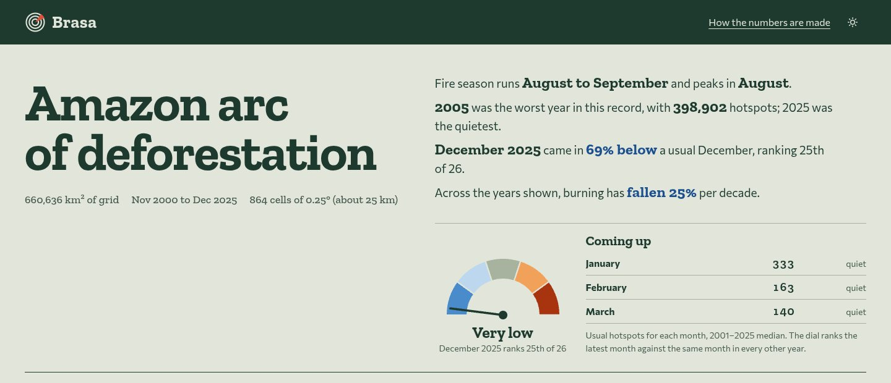
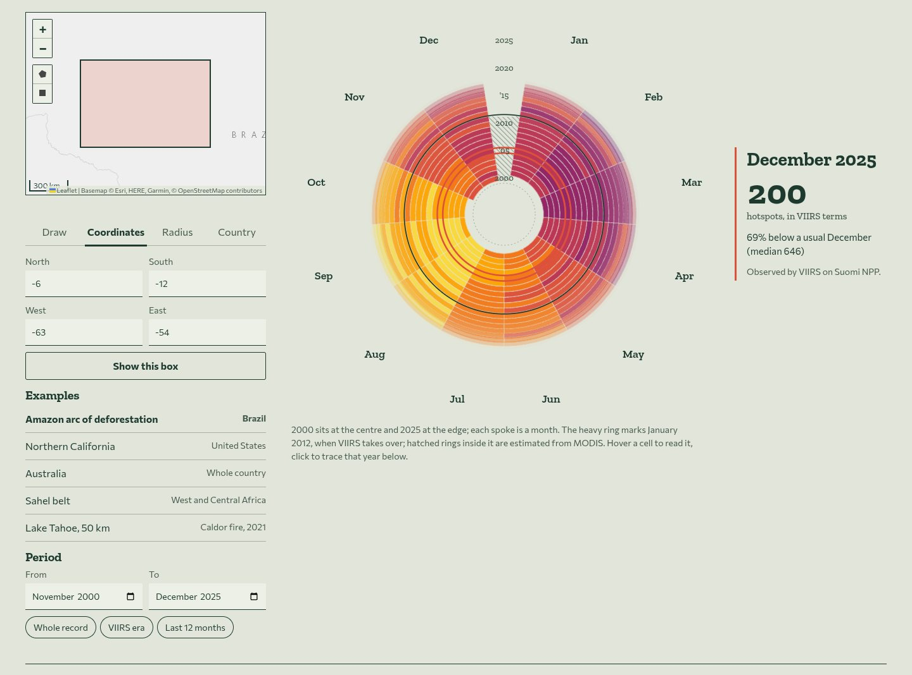
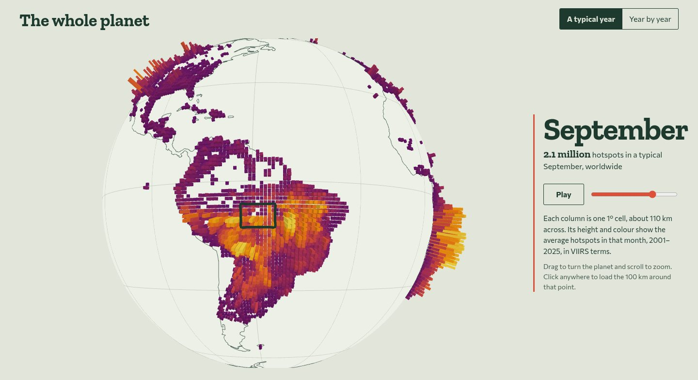
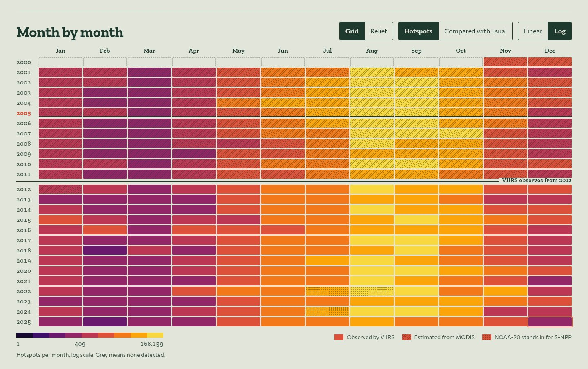
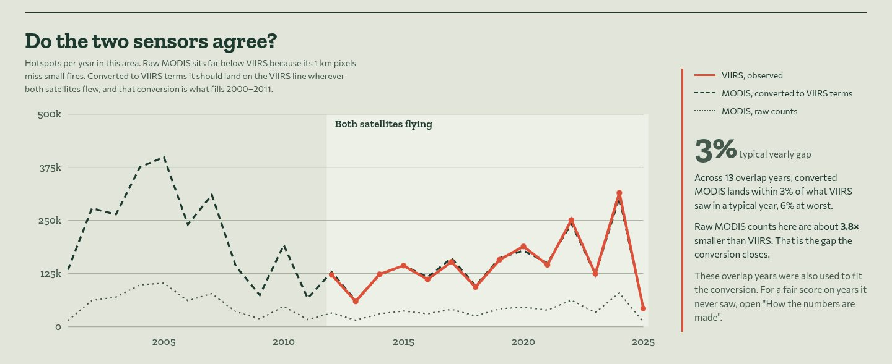

# Brasa — fire history, harmonized

**A burning-activity calendar for anywhere on Earth, built from 25 years of satellite fire detections put on one consistent scale.**

NASA Space Apps Challenge 2026 · *Harmonization of MODIS and VIIRS Hot Spots*



MODIS has detected active fires since 2000. VIIRS, its successor, has finer pixels and catches smaller fires, so it reports roughly four times as many hotspots for the same burning. The two records can't be compared directly. Brasa converts every MODIS month into **VIIRS-equivalent hotspots**, so the sensor of origin no longer matters and the patterns, trends and anomalies are what you see.

Pick an area by drawing it on the map, typing coordinates, choosing a point and radius, picking a country, or clicking the 3D globe. Then choose a period, and Brasa shows:

- **Fire rings.** A tree cross-section of the area's fire history: one ring per year (2001 at the centre), one spoke per month. Foresters read fire history from fire scars in tree rings, and Brasa draws the satellite record the same way.
- **A plain-language reading.** For example: "Fire season runs August to September and peaks in August. 2005 was the worst year… December 2025 came in 69% below a usual December."
- **A fire-danger dial and three-month outlook.** It ranks the latest month against the same month in every other year, and lists what the next three months usually bring.
- **A month-by-month calendar.** Years × months, coloured by hotspot count or compared with the usual month, with a 3D relief view.
- **The whole planet in 3D.** A three.js globe of 1° fire columns. "A typical year" animates the seasonal fire belt; "year by year" scrubs 2001–2025, optionally coloured against each cell's usual year.
- **"Do the two sensors agree?"** Raw MODIS, MODIS converted to VIIRS terms, and observed VIIRS for the selected area, so you can check the harmonization yourself.
- **A typical year and year-by-year charts**, plus **CSV exports**: the harmonized calendar and every raw hotspot in the area.

| | |
|---|---|
|  |  |
|  |  |

---

## Data

Everything comes from **NASA FIRMS**, using the country yearly summaries (standard processing, all columns):

| Sensor | Years | Files | Detections |
|---|---|---|---|
| MODIS Collection 6.1 (Terra + Aqua) | Nov 2000 – 2025 | 26 | 111 M |
| VIIRS 375 m, Suomi NPP | 2012 – 2025 | 14 | 281 M |
| VIIRS 375 m, NOAA-20 | 2018 – 2025 | 8 | 156 M |

That's 48 zips, 9.1 GB and **568 M detections**. These files don't include ocean hotspots. FIRMS MODIS starts on 2000-11-01.

**Filters.** Brasa keeps `type = 0` (presumed vegetation fire). That removes volcanoes, gas flares and other fixed industrial heat sources, and offshore detections. Low-confidence detections are dropped too: MODIS confidence below 30, and VIIRS confidence `l`.

## How the harmonization works

Reference sensor: **VIIRS Suomi NPP**, the longest VIIRS record. Grid: **0.25° cells × month**.

For months before VIIRS:

```
V̂[c,y,m] = k[c] · s[p(c),m] · M[c,y,m] · coverage[y,m]   if MODIS saw fire in cell c that month
         = b[p(c),m]                                     if MODIS saw nothing (cells that ever burned)
```

- **`k[c]`** is the cell's VIIRS/MODIS ratio, learned from the overlap years. It uses empirical-Bayes shrinkage: the 0.25° cell is pulled toward its 1° parent, the 1° toward its 5° parent, and the 5° toward the global ratio, using `k = (V + a·k_parent) / (M + a)` with `a = 20` MODIS detections. Cells with few fires borrow from their neighbourhood.
- **`s`** is a seasonal adjustment per 1° cell and calendar month, because fire size and type change through the season.
- **`b`** is the **small-fire floor**: the expected number of VIIRS detections in cell-months where MODIS saw nothing. VIIRS at 375 m catches fires too small for MODIS at 1 km, and leaving them out undercounts. This term made the biggest difference in validation.
- **Terra-only era (2000-11 → 2002-06).** Aqua wasn't flying yet, so Brasa uses a separate model fitted on Terra-only counts. Terra sees about a third of combined MODIS detections; the global ratio is 12.1× against 4.07× for Terra + Aqua.
- **Coverage.** MODIS months with missing days, such as the June 2001 Terra outage, are scaled by the number of days observed.
- **Training:** the 2012–2024 overlap, excluding months with satellite outages.

For VIIRS months, Brasa uses observed Suomi NPP. **The two Suomi NPP outage months, August 2022 and July 2024, are filled with NOAA-20**, which agrees with Suomi NPP to within 0.97–1.07× in normal years.

The code is in [`pipeline/harmonize.py`](pipeline/harmonize.py).

## Validation

**Time hold-out:** the models are trained on 2012–2018 only, then asked to predict 2019–2024 from MODIS, and compared with what Suomi NPP actually observed. Columns:

- **Typical error** is the median of `|ln((pred+1)/(obs+1))|` over region-months, so 0.21 means a typical miss of about 23%.
- **Anomaly r** is the correlation of month-versus-usual anomalies, which is what the calendar shows.

| Method | Areas | Bias | Typical error | Correlation (log) | Anomaly r |
|---|---|---|---|---|---|
| One global ratio (4.07×) | countries | −2.9 % | 0.34 | 0.962 | 0.66 |
| **Brasa** | countries | **−1.8 %** | **0.21** | **0.980** | **0.69** |
| *Two VIIRS satellites (best possible)* | countries | +0.6 % | 0.09 | 0.987 | 0.88 |
| One global ratio | 5° boxes | −2.9 % | 0.37 | 0.936 | 0.78 |
| **Brasa** | 5° boxes | **−1.8 %** | **0.26** | **0.968** | **0.82** |
| *Two VIIRS satellites* | 5° boxes | +0.6 % | 0.11 | 0.986 | 0.92 |

The *Two VIIRS satellites* rows score NOAA-20 against Suomi NPP. Two copies of the same instrument agreeing that well is the ceiling: no conversion can beat it.

We compared seven model variants. Spatial ratios alone made the bias *worse* (−7.5%), because the fires MODIS misses are concentrated in months it records as empty. The small-fire floor fixed that. A count-dependent ratio didn't help.

More checks:

- **Terra-only model** (train 2012–2018, test 2019–2021): bias +1.0%, country error 0.27, log correlation 0.976.
- **Before VIIRS existed.** In 2003–2010, when both Terra and Aqua flew, harmonizing the same months with the Terra-only model and the Terra+Aqua model agrees to 0.96–0.99× globally. The median country-year difference is 4.5%. Brazil (0.87) and India (1.22) are the outliers, so treat their 2001–02 values with care.
- **Continuity.** Global VIIRS-equivalent totals in millions: 2010 17.9 · 2011 17.6 · **2012 18.4** · 2013 15.7. There's no step at the sensor switch.
- **Real events.** Lake Tahoe's worst year is 2021 (the Caldor Fire). Los Angeles's is 2020 (the Bobcat Fire). On the 2020 anomaly globe, the Pantanal and the US West Coast stand out. Brazil shows its documented decline.

The full tables are in [`docs/validation/`](docs/validation/).

## Run it

Requirements: Python 3.12, about 25 GB of free disk for the raw zips plus derived data, and internet access in the browser for map tiles, fonts and three.js.

```bash
python3.12 -m venv .venv && .venv/bin/pip install -r requirements.txt

pipeline/00_download.sh ~/firms                                   # 48 zips, ~9 GB
.venv/bin/python -I pipeline/01_to_parquet.py ~/firms ~/firms/derived 2   # zips -> Parquet points
.venv/bin/python -I pipeline/02_aggregate.py  ~/firms/derived     # -> cell x month x sensor
.venv/bin/python -I pipeline/03_validate.py   ~/firms/derived     # hold-out scores (optional)
.venv/bin/python -I pipeline/04_build.py      ~/firms/derived     # -> harmonized tables
.venv/bin/python -I pipeline/05_check_terra.py ~/firms/derived    # Terra-only consistency (optional)
.venv/bin/python -I pipeline/06_sort_points.py ~/firms/derived    # latitude-sorted points, fast export
.venv/bin/python -I pipeline/07_globe.py      ~/firms/derived     # 1° grid for the 3D globe

cd app && ../.venv/bin/python -m uvicorn server:app --port 8765   # open http://localhost:8765
```

On a 16-core laptop, the processing steps take about five minutes in total. The download speed depends on the FIRMS servers. The app reads `~/firms/derived` by default; set `BRASA_DATA` to point it elsewhere.

## API

| Endpoint | |
|---|---|
| `POST /api/calendar` | `{area, start: "YYYY-MM", end: "YYYY-MM"}` returns a summary, monthly series (harmonized count, source, raw MODIS / VIIRS counts, converted MODIS, median, p10–p90, anomaly, uncertainty), climatology and yearly totals. About 0.1 s. |
| `POST /api/export/calendar.csv` | The monthly series as CSV. |
| `POST /api/export/points.csv` | Raw FIRMS detections in the area, all sensors, up to 500,000 rows. About 0.5 s for a 60 km circle over 25 years. |
| `GET /api/globe.bin` | 1° global grid (12 typical months + 25 years) for the globe. |
| `GET /api/meta`, `GET /api/countries` | Model summary, validation table and country list. |

`area` takes one of these forms:
- `{"type":"bbox","west":…,"south":…,"east":…,"north":…}`
- `{"type":"polygon","coordinates":[[lon,lat],…]}`
- `{"type":"point","lat":…,"lon":…,"radius_km":…}`
- `{"type":"country","name":"Brazil"}`

## Project layout

```
pipeline/   download, conversion, aggregation, harmonization model, validation, globe grid
app/        FastAPI server + DuckDB query engine (engine.py)
app/web/    static frontend: plain ES modules, Leaflet, three.js; no build step
docs/       screenshots and validation outputs
```

**Design.** The day theme is a sage survey-sheet palette, and the night theme is deep spruce. Type is Zilla Slab, in the spirit of routed-wood forest signs, with Commissioner for text. Data uses colour-blind-safe ramps (inferno-like for counts, blue↔orange for anomalies).

## Limits and next steps

- **2026 is not included yet.** The FIRMS yearly summaries end in 2025; adding 2026 needs a FIRMS archive or near-real-time request.
- Harmonization works on **counts per area and month**, not individual detections. The points CSV exports raw FIRMS detections labelled by sensor.
- Very small areas in the MODIS era are noisier. Every exported month carries a typical-uncertainty figure: ±21% for Terra+Aqua and ±27% for Terra alone.
- Hotspots count detected fire activity, not burned area or fire intensity.

## Credits

Fire data: NASA FIRMS (Fire Information for Resource Management System). MODIS Collection 6.1 and VIIRS 375 m active fire products, standard processing. Basemap © Esri, HERE, Garmin, © OpenStreetMap contributors. Coastlines from Natural Earth via world-atlas.
